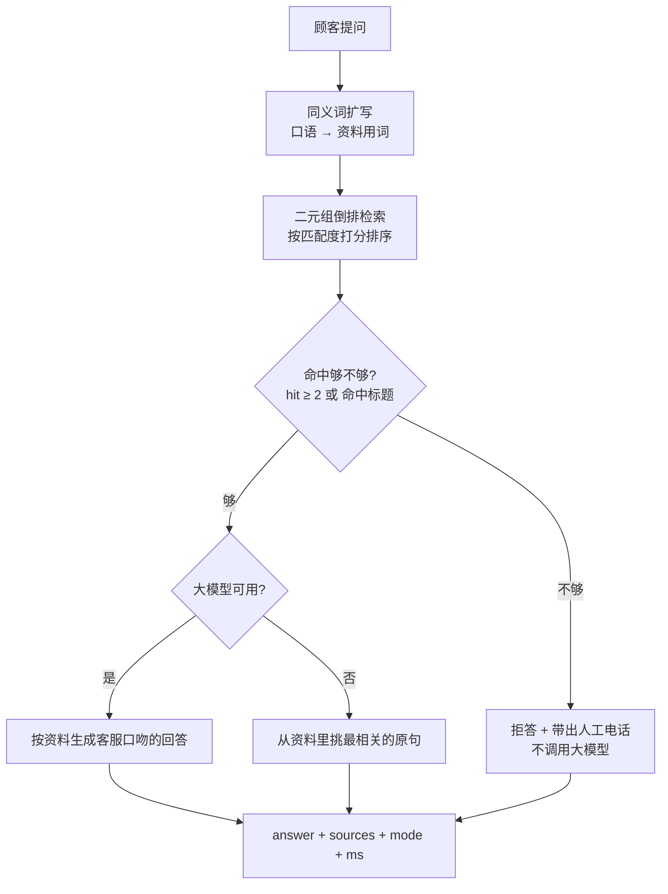

# 店铺 AI 客服 · 可交付版 Demo

[](https://github.com/DDD-333/AI-Customer-Service-Demo/actions/workflows/ci.yml)
[](https://www.python.org/)
[](.)
[](LICENSE)

> 把一个店的资料丢进去，得到一个**知道自己不知道什么**的客服 Agent。
> 零第三方依赖 —— 只用 Python 标准库，`python app.py` 就跑起来。

---

## 它和普通 RAG Demo 差在哪

普通 RAG Demo 的流程是：

```
提问 → 检索 → 把检索结果和问题一起丢给大模型 → 模型决定怎么答
```

这个项目的流程是：

```
提问 → 检索 → 先判断「这次检索够不够回答问题」
                  ├─ 不够 → 直接拒答，并带出人工电话 —— 根本不调用大模型
                  └─ 够   → 才调用大模型
```

这一个顺序差别带来三件事：

| | 普通 RAG Demo | 本项目 |
|---|---|---|
| **幻觉** | 靠提示词求模型「不要编」 | 模型压根看不到不相关的资料，**没有机会编** |
| **成本** | 资料里没有的问题照样发一次 API | 拒答路径的 API 调用次数 = **0** |
| **可解释** | 只有一个答案字符串 | 每个回答都带 `sources`（命中哪几段）和 `mode`（走哪条路径） |

**拒答由检索层的阈值决定，不由模型的「自觉」决定。** 这是整个项目唯一重要的设计决定。



---

## 特性

- **零依赖** —— 只用标准库（`http.server` / `urllib` / `re`），不需要 `pip install` 任何东西
- **检索层拒答闸门** —— 阈值 `hit ≥ 2 或命中标题` 来自实测回归集，不是拍脑袋定的
- **三级降级** —— `大模型 → 资料原句 → 拒答`，演示现场永远不会抛异常
- **多模型回退** —— 依次尝试多个模型名，记住哪个调通了后续直接复用
- **语料无关** —— 换客户只改一个 Markdown 文件，**不改一行代码**
- **可评价** —— 自带回归自检，把「答不上来」和「乱答」分成两类分别统计
- **零配置启动** —— 双击 `启动.bat`，自动选端口、自动开浏览器

---

## 快速开始

```bash
python app.py
```

浏览器会自动打开 `http://127.0.0.1:8765`（端口被占用时自动往后找，最多试 10 个）。
`Ctrl+C` 停止。

Windows 上直接双击 **`启动.bat`**。

> **没有配置密钥也能跑。** 这时走「纯检索模式」——不联网，回答直接从资料里取原句。
> 配置方法见下面的 [配置](#配置)。

---

## 配置

复制 `.env.example` 为 `.env` 并填值。`app.py` 启动时会自动读同目录的 `.env`
（用标准库手写，**不依赖 python-dotenv**）；已经设好的系统环境变量优先，不会被 `.env` 覆盖。
`.env` 已被 `.gitignore` 忽略，**不会进仓库**。

| 变量 | 必填 | 说明 |
|---|---|---|
| `ANTHROPIC_BASE_URL` | 是 | 任何 Anthropic Messages API 兼容的端点，例如 `https://api.deepseek.com/anthropic` |
| `ANTHROPIC_AUTH_TOKEN` | 是 | 密钥。按 `ANTHROPIC_AUTH_TOKEN` → `DEEPSEEK_API_KEY` → `ANTHROPIC_API_KEY` 顺序找，认一个即可 |
| `DEMO_MODEL` | 否 | 指定模型名。不填则按 `DEMO_MODEL` → `ANTHROPIC_MODEL` → `deepseek-chat` 依次回退 |
| `DEMO_NO_BROWSER` | 否 | 设为 `1` 则启动时不自动打开浏览器 |

---

## 换一个新客户（10 分钟，不改代码）

1. 新建一个目录，例如 `客户-某某店/`，放三个文件：

   ```
   客户-某某店/
   ├── 知识库.md     ← 客户资料，唯一必须改的文件
   ├── 客户.json     ← 可选：图标、快捷问题、自定义同义词
   └── 自检.py       ← 从 客户-驾校/ 复制一份改改
   ```

2. **`知识库.md` 的格式**（第一行是店名，`##` 是一个话题，话题下每行一条答案）：

   ```markdown
   # 某某店（某某路店）

   > 以 > 开头的行是给自己看的注释，不算资料。

   ## 营业时间
   - 每天 11:00 开门，22:30 打烊，中间不休息。
   - 最后点餐时间是 21:45。
   ```

3. **`客户.json` 三个字段都是可选的**：

   ```json
   {
     "icon": "🚗",
     "starters": ["报名多少钱？", "多久能拿证？"],
     "synonyms": { "班车": "接送", "几岁": "年龄 周岁" }
   }
   ```

4. **跑自检**：

   ```bash
   python 客户-某某店\自检.py
   ```

   自检会把问题分成两类，**两类都不许出错**：

   - **该答上来的**没答上来 → 资料里缺这个说法，去补一条，或者往 `synonyms` 里加一条
   - **该拒答的**答上来了 → 闸门太松，**这比第一类危险得多**

5. **启动**：

   ```bash
   python app.py 客户-某某店\知识库.md
   ```

> **资料写得越细，它答得越准。** 顾客可能问的每一种说法，都写成一条答案。

---

## 自检

| 版本 | 用例数 | 是否联网 | 状态 |
|---|---|---|---|
| `自检.py`（主店：老灶房·江湖菜） | 16（12 该答 + 4 该拒答） | 是（走完整链路） | 需要密钥 |
| `客户-驾校/自检.py`（顺安驾校） | 19（14 该答 + 5 该拒答） | 否（只测检索层） | ✅ **19/19 通过** |

两个自检脚本共用 `app.py` 里的**同一套检索逻辑**，所以自检过了，网页上就是过的。

回归集之所以要分成「该答的」和「该拒的」两类，是因为它们**失败的方式不一样**——
答不上来是**产品不好用**，乱答是**产品有害**。混在一个通过率里，就看不出来了。

---

## API

| 方法 | 路径 | 说明 |
|---|---|---|
| `GET` | `/` | 客服网页 |
| `GET` | `/api/health` | `{"llm": true, "model": "deepseek-chat"}` —— 大模型通没通 |
| `POST` | `/api/ask` | 请求 `{"q": "你们几点关门？"}` |

`POST /api/ask` 的返回：

```jsonc
{
  "answer":  "每天 11:00 开门，22:30 打烊哈～",
  "sources": ["营业时间"],          // 命中的资料话题标题
  "mode":    "llm:deepseek-chat",   // 见下表
  "ms":      940
}
```

| `mode` | 含义 |
|---|---|
| `llm:<模型名>` | 走了大模型 |
| `local` | 大模型不可用，回答取自资料原句 |
| `no-match` | **拒答** —— 检索层判定资料里没有，未调用大模型 |
| `error` | 内部异常，已兜底成一句道歉 |

---

## 设计取舍

**为什么只用标准库？**
这东西要在老板的电脑上跑给他看。现场 `pip install` 失败一次，演示就废了。

**为什么拒答阈值是 `hit ≥ 2 或命中标题`？**
因为真问题几乎总能命中 2 个以上二元组、或者命中标题；瞎问（「你们店里有篮球场吗」）命中的是正文里的无关词，落在门槛外。这个阈值是拿 19 条驾校用例调出来的，不是猜的。

**为什么文件名用中文？**
`知识库.md` / `客户.json` 是**给非技术的老板改的**。他不会理解 `knowledge_base.md`，但他看到「知识库」就知道那是什么。

**为什么不做流式输出？**
一次问答 1 秒左右，流式带来的复杂度换不回体验。以后接真客户、回答变长时再说。

---

## 已知限制

- 检索是**词法匹配**（二元组 + 同义词表），不是向量检索。查不到的说法要靠加同义词补，不能自动泛化。
- 没有多轮上下文，每一问都独立。
- 没有会话持久化，刷新页面就重来。
- 没有流式输出。
- 单进程 `ThreadingHTTPServer`，只适合演示和单人使用，未做压测。

## 路线图

- [x] 自检脚本返回退出码 + GitHub Actions，README 挂 CI 徽章
- [ ] 回归集从 19 条扩到 60 条，输出**召回率**和**拒答准确率**两个指标
- [ ] 拒答阈值扫描曲线，画出「召回 ↑ 幻觉 ↑」的权衡
- [ ] 前端迁移到 React + TypeScript，后端迁移到 FastAPI + PostgreSQL
- [ ] Dockerfile + docker-compose 一键起
- [ ] 多轮对话（Redis 存会话状态）
- [ ] 大模型结构化输出改用 prefill + schema 校验（见下方参考）

---

## 项目结构

```
AI客服Demo/
├── app.py                 主程序：检索 + 大模型 + 网页界面
├── 知识库.md              ★ 主店资料 —— 换客户只改这类文件
├── 自检.py                回归自检（主店 16 条，走完整链路）
├── 启动.bat               双击即跑
├── 启动-驾校.bat          同上，跑驾校版
├── 演示剧本.md            给老板现场演示的三步走剧本
├── 上门话术与报价.md      拜访客户的开场与报价
├── .env.example           配置模板（复制成 .env）
│
├── 客户-驾校/             ── 第二个客户，证明「换客户不改代码」
│   ├── 知识库.md          顺安驾校（茶园训练场）
│   ├── 客户.json          图标 🚗 + 同义词
│   └── 自检.py            19 条检索层回归，秒级完成
│
└── 扣子版/                ── 同一套人设，用低代码平台实现
    ├── 1-人设提示词.txt
    ├── 2-知识库.txt
    └── 3-搭建步骤.md
```

`客户-驾校/` 存在的意义不只是「又一个客户」——它证明这套东西**换客户不改代码**。

---

## 参考

- [anthropics/anthropic-quickstarts · customer-support-agent](https://github.com/anthropics/anthropic-quickstarts/tree/main/customer-support-agent) —— Anthropic 官方的同类参考实现。本项目从中吸收了「大模型结构化输出用 assistant prefill + schema 运行时校验」和「分阶段计时」两条做法；拒答路径的设计与之相反（**官方是让模型决定要不要转人工，本项目在调用模型之前就拦掉了**）。

---

## 许可

[MIT](LICENSE) © 2026 邓福海

演示所用商家（老灶房·江湖菜、顺安驾校）均为**虚构样例**，不是真实客户。
